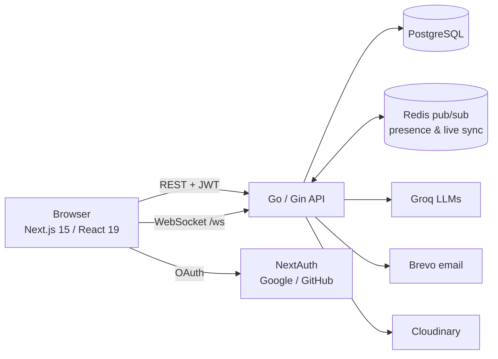

# SyncSpace

**A real-time collaborative workspace: Kanban boards, team task management and live flow diagrams, with AI that generates architecture diagrams from plain English.**

Built with **Next.js 15 + React 19** on the frontend and **Go (Gin) + PostgreSQL + Redis** on the backend. Multi-tenant (organizations, roles, invites), production-deployed, and structured to be extended.

> Live demo: _add your deployment URL_ · Demo video: _add link_

---

## Features

### Boards & tasks
- Boards with description, tags, status, health score (overdue / at-risk) and recent activity
- Five-stage pipeline (Planning → Design → Development → QA → Deployment) shown as **Kanban** (drag-and-drop), **Timeline** (Gantt-style) and **Priority × Phase matrix**
- Rich tasks: assignee, priority, start/due dates, tags, time estimate, checklist (subtasks), reference and flow-diagram links
- Inline editing on cards, full edit modal, optimistic updates with rollback
- **Tasks page** across all boards: *My tasks / All tasks*, grouped by Overdue / This week / Later, sortable, filterable, shareable URLs

### Flow diagrams
- Miro-style canvas (React Flow): 9 shapes, sticky notes, groups, images, editable tables, custom editable edges
- Undo/redo, copy/paste, snapping guides, keyboard shortcuts, minimap
- 8 templates, export to PNG / SVG / JSON, import JSON
- Per-node comment threads
- **Flows page** across all boards with search, filter and sort

### Real-time collaboration
- Live cursors and presence on diagrams (WebSocket + Redis pub/sub — scales across instances)
- Real-time voting on diagrams (approve / needs review / reject)
- **Presenter mode**: step through nodes as slides, viewers follow along

### AI (Groq)
- **Generate a diagram from a prompt** — optional web search for real service names, automatic model fallback chain, rate-limit-aware retries, output repair
- **Ask AI** about a board (e.g. "which tasks are overdue?")
- **Summarize** linked documents

### Teams & accounts
- Organizations with roles — **Owner, Admin, Member, Viewer** — enforced by the API and mirrored in the UI
- Email invites (Brevo), invite links, member management
- Email/password sign-in plus Google and GitHub OAuth (NextAuth)
- Profile with avatar upload (Cloudinary), notification preferences, activity history, notifications
- Dashboard with analytics charts (completion trend, distribution, team contribution)
- Light / dark theme, responsive layout

### Engineering
- Organization-scoped authorization on every endpoint (no cross-tenant access)
- JWT auth; AES-GCM encryption for sensitive payloads
- Stale-while-revalidate client caching — instant navigation after the first load
- Unit tests for the AI pipeline; diagnostic CLIs (`cmd/aitest`, `cmd/mailtest`)

> Not yet included: file attachments on tasks (the UI shows "coming soon").

---

## Architecture



| Repository | Contents |
|---|---|
| `SyncSpace` (this repo — app in `frontend/`) | Next.js app: UI, state (Zustand), canvas, NextAuth |
| `SyncSpace-Backend` | Go API: REST, WebSocket hub, AI, email, database schema |

**Frontend:** Next.js 15 (App Router), React 19, TypeScript, Tailwind CSS v4, Zustand, @xyflow/react, dnd-kit, Recharts, NextAuth.
**Backend:** Go 1.25, Gin, pgx (PostgreSQL), go-redis, gorilla/websocket, Groq API, Brevo, Cloudinary.

---

## Quick start

```bash
# 1. Backend
git clone <backend-repo-url> SyncSpace-Backend && cd SyncSpace-Backend
cp .env.example .env                 # set DB_URL and JWT_SECRET
psql "$DB_URL" -f schema.sql         # create the tables
go run ./cmd                         # → http://localhost:8080

# 2. Frontend (new terminal)
git clone <frontend-repo-url> SyncSpace && cd SyncSpace/frontend
cp .env.example .env.local           # set NEXTAUTH_SECRET
npm install && npm run dev           # → http://localhost:3000
```

Open http://localhost:3000 and sign up — the onboarding wizard creates your first organization and board.

**Full instructions** — every environment variable, optional services, deploying to Render, and troubleshooting — are in **[SETUP.md](SETUP.md)**.

---

## Project structure

```
SyncSpace/frontend/src/
  app/                  Next.js routes (dashboard, boards, tasks, flows, auth, onboarding)
  app/components/       UI — kanban/, flow/ (canvas), ai/, tasks/, flows/
  app/store/            Zustand stores (board, tasks, org-wide tasks/flows, user…)
  app/hooks/            useDiagram, useFlowPresence, useEditMode (permissions)…
  lib/                  API client (JWT, encryption), WebSocket client
  pages/api/auth/       NextAuth handler

SyncSpace-Backend/
  cmd/                  main.go (server); aitest, mailtest (diagnostic CLIs)
  routes/, controller/  HTTP layer
  service/              business logic; service/database/ = repositories
  pkg/                  groq, ws (hub), redis, email, cloudinary, crypto
  schema.sql            full database schema
  migrations/           incremental SQL for existing databases
  API_DOCS.md           endpoint reference
```

---

## License

_Choose and add a license before distributing (e.g. single-product vs. extended commercial use)._
